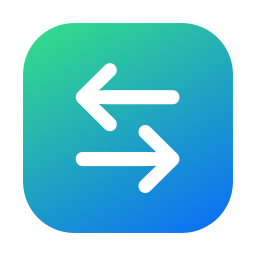

<p align="center">
  
</p>

<h1 align="center">iFork</h1>

<p align="center"><b>The fastest way to move files between your Android phone and your Mac.</b><br>
Uses your USB cable <i>and</i> your Wi-Fi at the same time.</p>

<p align="center">
  <a href="https://github.com/haryprasadh/i-fork/releases/latest"><b>⬇ Download for Mac</b></a> ·
  macOS 14+ · Apple silicon & Intel · Free & open source
</p>

---

## Why it's fast

Most tools push files through one link (MTP or `adb`). iFork opens **two lanes**, USB and Wi-Fi, and splits the work between them.

Measured on a Nothing Phone (2a) (USB 2 port) with an M-series MacBook and real WhatsApp media:

| Transfer | `adb` command line | **iFork** |
|---|---|---|
| 1.35 GB of videos, phone → Mac | 41 MB/s | **65 MB/s** |
| 1,248 photos (185 MB), phone → Mac | 17 MB/s | **41 MB/s** |
| 1.35 GB of videos, Mac → phone | 34 MB/s | 35 MB/s |

## Get started (5 minutes, once)

**1. Install adb** (the small tool iFork uses to talk to Android):

```sh
brew install android-platform-tools
```

No Homebrew? Get it from [brew.sh](https://brew.sh).

**2. Install iFork.** Download `iFork.zip` from [Releases](https://github.com/haryprasadh/i-fork/releases/latest), unzip it and drag **iFork** into **Applications**.

The app isn't notarized yet, so macOS blocks the first launch. Either right-click iFork → **Open** → **Open**, or run:

```sh
xattr -dr com.apple.quarantine /Applications/iFork.app
```

**3. Prepare your phone:**

1. **Settings → About phone** → tap **Build number** 7 times (this unlocks Developer options).
2. **Settings → System → Developer options** → turn on **USB debugging**.
3. Plug the phone in. When it asks, tap **Allow** and tick **Always allow from this computer**.
4. *Optional, for the extra speed:* also turn on **Wireless debugging**, with the phone on the same Wi-Fi as your Mac. iFork finds it on its own.

That's it. Open iFork and your phone shows up.

## How to use

| To… | Do this |
|---|---|
| Copy from phone to Mac | Select files → **⌘S** (saves to Downloads), or drag them to Finder |
| Copy from Mac to phone | Drag files or folders from Finder onto the list, or **⌘O** |
| Save somewhere else | Right-click → **Save to…** |
| Open a folder | Double-click it, or use the sidebar (Camera, Screenshots, WhatsApp…) |
| Go back / up | **⌘[** / **⌘↑** |
| New folder / delete on phone | **⇧⌘N** / select → **Delete** |

The bar at the bottom shows live speed per lane (`USB 38 · Wi-Fi 22`), the time left, and a **Show in Finder** button when the copy is done.

Copying the same folder again skips files that are already there, so an interrupted copy can resume.

### No cable? Wi-Fi Drop (beta)

Click **Wi-Fi Drop (QR)** in the sidebar and scan the code with your phone's camera. A page opens in the phone's browser where you can send files to the Mac or download files the Mac shares. You don't need an app or USB debugging; the phone and Mac just need to be on the same Wi-Fi.

## How it works

- **No `adb` process per file.** iFork talks to the adb server's socket directly, using the same file-sync protocol `adb push/pull` uses, so it gets exact progress and no per-file process start.
- **Two lanes.** With Wireless debugging on, iFork finds the phone's wireless adb port through the USB connection and connects it automatically.
- **Smart split.** USB takes the biggest files. Wi-Fi takes the smallest files, but only when that finishes the job sooner.
- **No compression.** Photos and videos are already compressed, and turning compression off was measurably faster.

```
Sources/IFork/
├── Adb/        socket client, sync protocol, device + lane discovery, phone file ops
├── Transfer/   lane scheduler, workers, live speed
├── Wifi/       Wi-Fi Drop: HTTP server, phone web page, QR code
└── UI/         SwiftUI views
```

## Build from source

Requires the Xcode Command Line Tools (`xcode-select --install`). Full Xcode isn't needed.

```sh
git clone https://github.com/haryprasadh/i-fork.git
cd i-fork
./scripts/bundle.sh --install     # builds build/iFork.app and copies it to ~/Applications
```

Benchmark your own phone from the terminal:

```sh
~/Applications/iFork.app/Contents/MacOS/iFork --bench pull "/sdcard/DCIM/Camera" /tmp/ifork-test
~/Applications/iFork.app/Contents/MacOS/iFork --bench pull "/sdcard/DCIM/Camera" /tmp/ifork-test --usb-only
```

## Troubleshooting

| Problem | Fix |
|---|---|
| "Connect your Android phone" stays on screen | Check USB debugging is on; try another cable (some are charge-only) |
| "Tap Allow on your phone" | Unlock the phone and accept the prompt |
| Only the USB lane is green | Turn on **Wireless debugging** and put the phone on the same Wi-Fi as the Mac |
| Speed stuck around 40 MB/s | Your phone or cable is USB 2; turn on the Wi-Fi lane for more |

## Roadmap

- Faster Mac → phone (send files back to back without waiting for each one's acknowledgement)
- Show the phone in Finder as a drive
- Signed and notarized builds

## License

[MIT](LICENSE)
